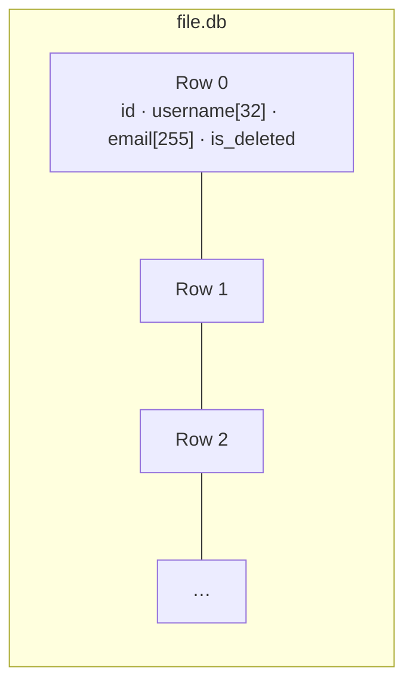

# SimpleDB-C


A small single-table storage engine written from scratch in C, with an interactive SQL-like shell and binary on-disk persistence.

I built it to understand what a database actually does underneath: how records are laid out on disk, how they are read back, updated and deleted in place, and how to manage memory by hand without leaks.

## Features

- **Interactive REPL** — a shell that accepts `insert`, `select`, `update` and `delete`, plus the meta-commands `.help` and `.exit`.
- **Binary persistence** — records are written to `file.db` as fixed-size binary rows and survive restarts.
- **In-place updates and soft deletes** — `update` and `delete` seek directly to a row's offset in the file; deleted rows are flagged rather than physically removed.
- **No dependencies** — only the C standard library and POSIX.

## How data is stored

Every record is a fixed-size `User` row, so row *n* always starts at byte `n × sizeof(User)`. That is what makes direct `fseek` access possible.



## Build and run

You need `gcc` or `clang`.

```bash
git clone https://github.com/AlexandruAchilleF/database-engine-in-C.git
cd database-engine-in-C
gcc src/main.c src/engine_core.c -o db
./db
```

The first `insert` creates `file.db` in the current directory.

## Usage

```text
db > .help

------- Help Menu -------
.exit   : Exit the database.
insert <username> <email> : Insert user.
select  : Show users.
delete <id> : Delete user.
update <id> <username> <email> : Update user.
-------------------------

db > insert firstuser user@mail.com
Executed.

db > insert user2 seconduser@generic.web
Executed.

db > select
ID   | Username                        | Email
--------------------------------------------------------------
1    | firstuser                       | user@mail.com
2    | user2                           | seconduser@generic.web
--------------------------------------------------------------
Executed.

db > update 1 newname new@mail.com
Executed.

db > delete 2
Executed.

db > .exit
```

## Project structure

| File | Role |
| --- | --- |
| `src/main.c` | REPL loop and startup (loads row count and max id from disk) |
| `src/engine_core.c` | Command parsing, statement execution, file I/O |
| `src/engine_core.h` | Engine function declarations |
| `src/common.h` | Shared types: `User` row, statements, result codes |

## Concepts explored

- Manual memory management with `malloc` / `free`
- Binary file I/O with `fwrite`, `fread` and `fseek`
- Parsing user input with `sscanf`
- Splitting a C program into modules with headers

## Limitations and roadmap

The schema is currently fixed to one table (`id`, `username`, `email`) and every operation does a linear scan. The next milestones are:

1. Fix known correctness issues (zeroing rows before writing them, rejecting updates on deleted rows, EOF handling in the REPL).
2. Add a `Makefile`, automated tests and CI with sanitizers.
3. Replace the flat file with a pager and a B+ tree index.
4. Support `WHERE` clauses and `CREATE TABLE`.

The full plan is in [`roadmap.md`](roadmap.md) (in Romanian).
