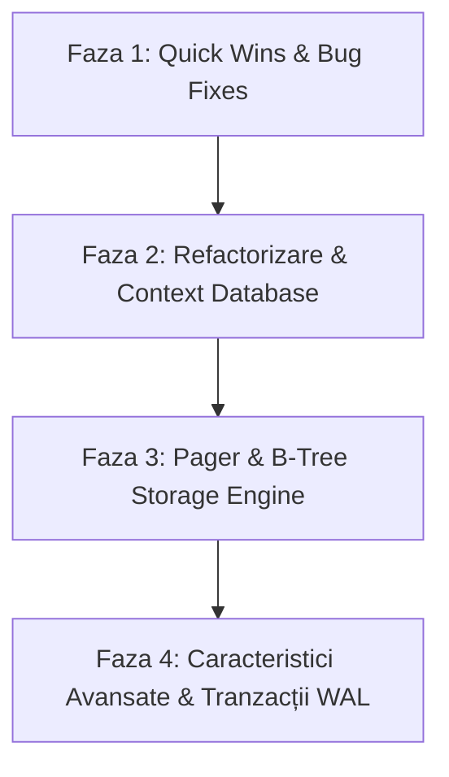

# Roadmap de Îmbunătățiri

Acest document reprezintă analiza tehnică completă a bazei de cod a motorului de baze de date și planul strategic de îmbunătățire structurat pe componente, priorități și etape de dezvoltare.

---

## 1. Evaluarea Stării Actuale a Proiectului

### Puncte Forte
- **Simplitate și Claritate:** Proiect minimalist, ușor de urmărit, fără dependențe externe complicate.
- **Persistență Binară Funcțională:** Datele sunt salvate și reîncărcate dintr-un fișier binar (`file.db`).
- **Structură Modulară de Bază:** Separare între REPL (`src/main.c`), logica motorului (`src/engine_core.c`) și definițiile de date (`src/common.h`, `src/engine_core.h`).
- **Punct Excelent de Plecare Didactic:** Inspirat din arhitectura SQLite (REPL -> Parser -> Executiv).

### Limitări Majore Curente
- **I/O Ineficient:** Fiecare operațiune (`insert`, `select`, `update`, `delete`) deschide și închide fișierul cu `fopen`/`fclose`.
- **Căutare Liniară $O(N)$:** Nu există mecanism de indexare (B-Tree sau Hash Index); orice căutare parcurge secvențial întregul fișier.
- **Stare Globală:** Variabilele globale `global_rows_number` și `max_id` împiedică modularizarea, deschiderea mai multor baze de date sau rularea testelor unitare.
- **Vulnerabilitate de Scurgere de Memorie pe Disc:** Rândurile salvate pe disc conțin octeți neinițializați de pe stivă.
- **Lipsă Sistem de Build și Teste:** Compilarea se face manual prin linia de comandă, fără `Makefile` sau teste automate.

---

## 2. Bug-uri Critice, Securitate și Integritatea Datelor (Prioritate Imediată)

### 2.1 Scurgere de Memorie de pe Stivă pe Disc (Information Disclosure Leak)
- **Problema:** Structura `User` are dimensiunea de 292 octeți (include `username[32]` și `email[255]`). Când se apelează `sscanf`, se populează doar primele caractere; restul bufferului și padding-ul structurii rămân neinițializate de pe stivă. Apelul `fwrite(&(statement->row_to_modify), sizeof(User), 1, file)` scrie date reziduale din memorie direct în `file.db`.
- **Soluție:** Utilizarea obligatorie a `memset(&statement->row_to_modify, 0, sizeof(User));` înainte de populare sau serializarea explicită câmp cu câmp.

### 2.2 Operații `delete` și `update` pe Înregistrări Deja Șterse
- **Problema:** În funcțiile `execute_delete` și `execute_update`, căutarea verifică doar `if (row.id == statement->row_to_modify.id)`. Dacă rândul a fost deja marcat cu `is_deleted = true`:
  - `delete` îl marchează din nou ca șters și returnează `EXECUTE_SUCCESS`.
  - `update` modifică datele unui rând șters, îl lasă șters și returnează `EXECUTE_SUCCESS`, dar rândul nu va mai apărea niciodată la `select`.
- **Soluție:** Modificarea condiției în `if (!row.is_deleted && row.id == statement->row_to_modify.id)`.

### 2.3 Calcul Eronat și Fragil pentru `max_id` și `global_rows_number`
- **Problema 1:** `find_max_id(FILE *file)` citește doar ultima înregistrare din fișier prin `fseek(file, -sizeof(User), SEEK_END)`. Dacă ultima înregistrare a fost ștearsă sau dacă în viitor se refolosesc sloturi libere, ID-ul maxim va fi calculat greșit.
- **Problema 2:** Dacă `file.db` este gol (0 octeți) sau corupt (ex: dimensiune ce nu este multiplu de `sizeof(User)`), `find_rows_number` nu validează dacă `ftell(file)` a eșuat (-1L) sau dacă există corupere parțială.
- **Problema 3:** La ștergerea unui rând, `global_rows_number` nu reflectă numărul de rânduri active, ci numărul de sloturi din fișier.
- **Soluție:** Scanarea completă a fișierului la deschidere pentru găsirea `max_id` real și a numărului de rânduri active, sau salvarea acestor metadate într-un header dedicat la începutul fișierului.

### 2.4 Ignorarea Valorilor de Retur pentru Apelurile I/O
- **Problema:** Nu se verifică valoarea de retur pentru `fwrite`, `fread`, `fseek` sau `fclose`. Dacă discul este plin sau apar erori de permisiuni, `execute_insert` incrementează oricum `max_id` și `global_rows_number` și returnează `EXECUTE_SUCCESS`.
- **Soluție:** Verificarea fiecărui apel I/O (`if (fwrite(...) != 1) return EXECUTE_ERROR;`).

### 2.5 Crash la EOF (`Ctrl+D`) în REPL
- **Problema:** În `read_input()`, dacă utilizatorul apasă `Ctrl+D`, `getline` returnează `-1`. Codul curent afișează `Reading Error.` și apelează direct `exit(EXIT_FAILURE)`, fără să curețe resursele (`free_input_buffer`).
- **Soluție:** Tratarea valorii `-1` cu verificarea `feof(stdin)` pentru a permite o ieșire curată (`exit(EXIT_SUCCESS)`), eliberând memoria alocată.

### 2.6 Probleme de Parsare și Validare Input
- **Prefix Matching Bug:** În `prepare_statement`, verificarea `strncmp(input_buffer->buffer, "insert", 6) == 0` acceptă și comenzi eronate precum `insertfoo`, `selectall`, `deleted` etc.
- **Lipsă suport pentru spații / ghilimele:** `sscanf("%31s %254s")` se oprește la primul spațiu. Nu se pot insera nume precum `"Popescu Ion"` sau emailuri cu delimitatori.
- **Ignorare parametri suplimentari:** O comandă de tipul `insert user user@mail.com argumente_in_plus` este acceptată fără avertisment.
- **Case-Sensitivity:** Comenzile scrise cu majuscule (`INSERT`, `SELECT`) eșuează.
- **Spații la început de rând (Leading Whitespace):** Dacă utilizatorul tastează `  select`, comanda nu este recunoscută.
- **Tasta Enter (Input Gol):** Dacă utilizatorul apasă simplu `Enter`, programul afișează `Unrecognized keyword.` în loc să afișeze din nou promptul.

---

## 3. Arhitectură și Sistem de Stocare (Core Storage Engine)

### 3.1 Pager și Buffer Pool (Eliminarea `fopen`/`fclose` repetitiv)
- **Concept:** Un motor de baze de date nu deschide/închide fișierul la fiecare interogare.
- **Ce trebuie implementat:**
  - Un modul `pager.c / pager.h` care menține descriptorul de fișier deschis pe durata sesiunii.
  - Divizarea fișierului în **pagini de dimensiune fixă** (ex: 4096 octeți / 4KB).
  - Un cache în memorie (Buffer Pool de ex. 100 de pagini) cu politică de înlocuire LRU (Least Recently Used).
  - Marcarea paginilor modificate ca `dirty` și salvarea lor controlată pe disc (`flush`).

### 3.2 Indexare prin B-Tree / B+ Tree
- **Problema actuală:** Toate operațiile (`SELECT`, `UPDATE`, `DELETE`) execută un Full Table Scan ($O(N)$).
- **Îmbunătățire:**
  - Implementarea unui arbore B+ Tree stocat pe pagini.
  - Noduri interne (Internal Nodes) pentru rutarea căutărilor după cheia primară (`id`).
  - Noduri frunză (Leaf Nodes) ce conțin înregistrările propriu-zise sau pointeri către sloturi.
  - Complexitate redusă la $O(\log N)$ pentru căutare, inserare și ștergere.

### 3.3 Eliminarea Stării Globale (Context Struct)
- **Problema:** `extern int global_rows_number; extern int max_id;` limitează arhitectura.
- **Soluție:** Încapsularea completă a stării într-o structură de context:
  ```c
  typedef struct {
      Pager *pager;
      uint32_t root_page_num;
      uint32_t num_rows;
      uint32_t max_id;
  } Table;

  typedef struct {
      Table *table;
      char *db_filename;
  } Database;
  ```

### 3.4 Bază de Date Configurabilă prin Linia de Comandă
- **Problema:** Numele fișierului `"file.db"` este hardcodat în cod.
- **Soluție:** Preluarea numelui fișierului ca argument din `main(int argc, char *argv[])`:
  ```bash
  ./db production.db
  ```
  Dacă nu este furnizat, se poate folosi un fișier implicit sau o bază de date în memorie (`:memory:`).

### 3.5 Antet de Fișier Binar (Database Header)
- **Concept:** Fișierele de baze de date profesionale (SQLite, PostgreSQL) încep cu o zonă de metadate.
- **Structură propusă (primii 100 octeți):**
  - Magic Number: `0x53444231` ("SDB1" - SimpleDB v1).
  - Dimensiunea paginii (ex: 4096).
  - Numărul total de pagini.
  - Versiunea schemei.
  - Numărul rădăcinii B-Tree.
  - Checksum pentru validarea integrității fișierului împotriva coruperii accidentale.

### 3.6 Serializare Independentă de Arhitectură (Platform & Packing Independence)
- **Problema:** `fwrite(&row, sizeof(User))` depinde de ordinea octeților (endianness) și de alinierea/padding-ul compilatorului pe 32-bit vs 64-bit. Un fișier generat pe x86 s-ar putea să nu fie citit corect pe ARM.
- **Soluție:** Funcții explicite de serializare/deserializare binară:
  ```c
  void serialize_user(const User *source, void *destination);
  void deserialize_user(const void *source, User *destination);
  ```

### 3.7 Gestiunea Spațiului Șters și Compactare (`VACUUM` / Free List)
- **Problema:** În prezent, fișierul doar crește. Înregistrările șterse ocupă spațiu pe disc la nesfârșit.
- **Soluții posibile:**
  1. **Free List:** Menținerea unei liste înlănțuite de sloturi eliberate pe care `insert` le refolosește înainte de a adăuga la sfârșitul fișierului.
  2. **Comandă `.vacuum` / `.compact`:** Reconstruirea fișierului prin copierea doar a înregistrărilor active într-un fișier temporar și redenumirea acestuia.

---

## 4. Tranzacții, Concurrency și Siguranță la Crash (ACID)

### 4.1 Siguranță la Crash: Write-Ahead Logging (WAL) sau Rollback Journal
- **Problema:** Dacă procesul se oprește forțat (pană de curent, SIGKILL) în timpul unei scrieri, fișierul poate rămâne într-o stare coruptă.
- **Îmbunătățire:**
  - Jurnal de tranzacții: scrierea modificărilor într-un fișier separat `.wal` sau `.journal` înainte de aplicarea lor în fișierul principal.
  - La pornire: procedură de recuperare automată (Recovery / Redo / Undo).

### 4.2 Sincronizare pe Disc (`fsync`)
- Sistemul de operare ține datele în cache-ul de pagini al kernel-ului. Pentru a asigura durabilitatea reală (D-ul din ACID), este necesar apelul `fflush()` urmat de `fsync(fileno(file))` la finalul operațiilor de scriere.

### 4.3 Blocarea Fișierului (Concurrency & File Locking)
- Dacă doi utilizatori rulează `./db file.db` simultan, fișierul va fi corupt.
- **Soluție:** Utilizarea `flock()` sau `fcntl()` pentru a obține un lock partajat (Shared Lock pentru citire) sau exclusiv (Exclusive Lock pentru scriere).

---

## 5. Capabilități de Interogare și Extensibilitate SQL

### 5.1 Clauze `WHERE` Flexibile
- Trecerea de la comenzi rigide precum `delete <id>` la o sintaxă SQL standard:
  ```sql
  SELECT * WHERE id = 5;
  SELECT * WHERE email = 'user@mail.com';
  DELETE WHERE id > 10;
  UPDATE WHERE id = 1 SET email = 'nou@mail.com';
  ```

### 5.2 Clauze de Sortare și Paginare
- Suport pentru `ORDER BY id ASC / DESC`.
- Suport pentru `LIMIT <n> OFFSET <m>` pentru afișarea paginată a rezultatelor.

### 5.3 Funcții de Agregare și Căutare
- `COUNT(*)`: returnarea numărului de înregistrări active.
- `MIN(id)`, `MAX(id)`.
- Căutare parțială cu `LIKE` (ex: `WHERE email LIKE '%@gmail.com'`).

### 5.4 Scheme Dinamice (`CREATE TABLE`)
- În prezent schema este fixată pe `id`, `username[32]`, `email[255]`.
- Arhitectură viitoare: tabel de sistem (Catalog / Data Dictionary) care descrie tabelele, coloanele și tipurile acestora (`INT`, `VARCHAR`, `FLOAT`, `BOOL`).

---

## 6. Interfață Utilizator și Experiență CLI (REPL UX)

### 6.1 Integrare Bibliotecă de Linie de Comandă (`linenoise`)
- **Problema:** În prezent, utilizatorul nu poate naviga cu tastele săgeți (apar caractere escape de tipul `^[[A`), nu are istoric de comenzi și nici autocompletare.
- **Soluție:** Integrarea unei biblioteci ușoare C fără dependențe mari, precum [linenoise](https://github.com/antirez/linenoise) (un singur fișier C și un header):
  - Istoric salvat între sesiuni (`.db_history`).
  - Suport complet pentru săgeți stânga/dreapta/sus/jos.
  - Autocompletare cu tasta `Tab` pentru comenzi și cuvinte cheie.

### 6.2 Formatare Tabelară Dinamică și Modernă
- Calcularea automată a lățimii coloanelor în funcție de conținutul efectiv al celulelor.
- Folosirea caracterelor ASCII sau Unicode de delimitare (`┌─┬─┐`, `│ │ │`, `└─┴─┘`) pentru o prezentare vizuală atractivă.
- Afișarea timpului de execuție la finalul fiecărei comenzi (ex: `Query took 0.42 ms`).

### 6.3 Comenzi Meta Suplimentare
- `.tables`: Listează tabelele existente.
- `.schema`: Afișează structura tabelului curent.
- `.stats`: Afișează numărul de pagini, rânduri active, rânduri șterse și dimensiunea pe disc.
- `.dump`: Exportă datele în format SQL text (`INSERT INTO ...`).
- `.clear`: Curăță ecranul terminalului.
- `.vacuum`: Reorganizează fișierul și eliberează spațiul neutilizat.

---

## 7. Calitatea Codului, Sistem de Build și Tooling

### 7.1 Crearea unui `Makefile` Modern și Profesional
În prezent, compilarea este documentată exclusiv ca o comandă manuală `gcc`. Este esențial un `Makefile` cu:
- Target-uri: `all`, `build`, `test`, `clean`, `format`, `sanitize`.
- Flag-uri de compilare stricte: `-Wall -Wextra -Wpedantic -Werror -Wstrict-prototypes -std=c11`.

### 7.2 Corectarea Inconsistențelor din Codul Existent
- **Header Guard în `engine_core.h`:** În prezent este `#ifndef FUNCTIONS_H`, deși fișierul a fost redenumit în `engine_core.h`. Trebuie actualizat la `#ifndef ENGINE_CORE_H`.
- **Prototipuri Funcții fără Argumente:** În C, `void print_prompt()` înseamnă argumente nespecificate. Trebuie declarat `void print_prompt(void);` și `InputBuffer *new_input_buffer(void);` pentru conformitate C11/C23.
- **Parametri Neutilizați:** Curățarea parametrilor neutilizați din `main(argc, argv)` și `execute_select(statement)`.
- **Referințe în `README.md`:** La linia 21 este menționat `src/core_engine.c` în loc de `src/engine_core.c`.

### 7.3 Actualizarea `.gitignore`
Fișierul `.gitignore` actual ignoră `main` și `*.db`, dar:
- Nu ignoră executabilul `db` generat în rădăcină.
- Nu ignoră folderul de configurare `.idea/` al IDE-ului.
- Nu ignoră fișierele obiect (`*.o`) sau fișierele de depanare (`*.dSYM`).

### 7.4 Suită de Teste Automate
- **Teste Unitare:** Testarea separată a buffer-ului de intrare, a parser-ului de comenzi și a serializării.
- **Teste de Integrare (End-to-End):** Script în Python (`pytest`) sau Bash care execută comenzi pe un binar compilat și verifică:
  - Corectitudinea persistenței între reporniri.
  - Corectitudinea la operații mari (ex: inserare a 10.000 de înregistrări).
  - Comportamentul la comenzi invalide sau date corupte.

### 7.5 Analiză Dinamică și Statică
- Rularea regulată a suitelor cu sanitizere activate:
  ```bash
  gcc -fsanitize=address,undefined -g ...
  ```
- Verificare cu `valgrind --leak-check=full --track-origins=yes ./db`.
- Linter static: `clang-tidy` și formatare consecventă cu `clang-format`.

### 7.6 CI/CD Automation (GitHub Actions)
- Adăugarea unui workflow `.github/workflows/ci.yml` care să ruleze automat la fiecare `push` și `pull request`:
  - Compilare pe multiple sisteme de operare (Linux Ubuntu, macOS).
  - Rularea testelor unitare și de integrare.
  - Verificarea formatării cu `clang-format`.
  - Verificarea fără warning-uri cu `-Werror`.

---

## 8. Plan de Implementare pe Etape (Prioritizare Recomandată)



### Faza 1: Quick Wins & Rezolvarea Bug-urilor Critice
- [ ] Curățare `memset` pe structura `User` pentru a opri scurgerea de memorie reziduală pe disc.
- [ ] Verificare `!row.is_deleted` la operațiunile de `update` și `delete`.
- [ ] Adăugare `Makefile` cu target-uri complete și flag-uri de avertizare stricte.
- [ ] Corectare header guard `ENGINE_CORE_H`, prototipuri `(void)` și mențiuni greșite din `README.md`.
- [ ] Actualizare `.gitignore` (`db`, `.idea/`, `*.o`, `*.dSYM`).
- [ ] Tratare corectă a `Ctrl+D` (EOF) și a liniilor goale (tasta Enter).
- [ ] Adăugare verificare erori I/O la toate apelurile `fread`/`fwrite`/`fseek`.

### Faza 2: Modularizare, Context Struct & CLI Robust
- [ ] Eliminarea variabilelor globale `global_rows_number` și `max_id`.
- [ ] Crearea structurii de context `Database` / `Table` și transmiterea pointerului către funcțiile de execuție.
- [ ] Permiterea specificării fișierului bazei de date prin linia de comandă (`./db <filename>`).
- [ ] Refactorizarea parser-ului: tokenizare mai sigură, suport pentru comenzi case-insensitive și eliminarea bug-ului `strncmp`.
- [ ] Integrarea `linenoise` pentru istoric și navigare cu tastele săgeți.
- [ ] Implementarea unui script de teste de integrare end-to-end (ex: `tests/test_db.py`).

### Faza 3: Pager, Binar Portabil & Structură B-Tree
- [ ] Implementarea modulului `Pager` (pagini de 4KB, cache în memorie, scriere controlată).
- [ ] Antet de fișier cu Magic Number (`SDB1`), număr pagini și verificare integritate.
- [ ] Serializare/deserializare independentă de arhitectură.
- [ ] Structură de date B-Tree / B+ Tree pentru stocarea rândurilor indexate după `id`.
- [ ] Căutare binară în cadrul nodurilor și divizare a paginilor (split page) la depășirea capacității.
- [ ] Implementarea comenzii `.vacuum` sau mecanism de Free List pentru refolosirea spațiului șters.

### Faza 4: ACID, Concurrency & Extensibilitate SQL
- [ ] Implementare mecanism de locking la nivel de fișier (`flock`).
- [ ] Write-Ahead Logging (WAL) pentru tranzacții atomice și protecție la crash.
- [ ] Parser extins pentru clauze `WHERE` cu operatori de comparație.
- [ ] Paginare (`LIMIT`, `OFFSET`) și sortare (`ORDER BY`).
- [ ] Suport pentru crearea tabelelor dinamice (`CREATE TABLE`) și tipuri multiple de date.
- [ ] Integrare GitHub Actions pentru rularea automată a testelor și verificărilor de securitate a memoriei.
